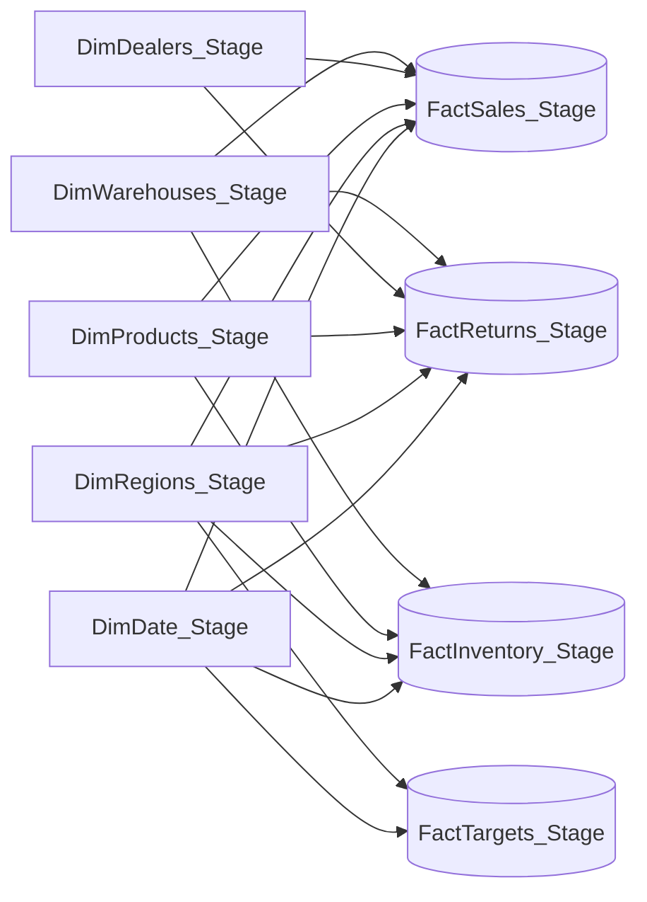

# itel Pakistan | Sales & Operations Analytics


**An end-to-end SQL Server and Power BI portfolio case study using synthetic smartphone distribution data.**

**Stack:** Excel-compatible CSV data · Microsoft SQL Server · SQL Server Management Studio (SSMS) · Power BI Desktop · Power Query · DAX  
**Reporting period:** January 2025 – September 2026 (21 months) · **Currency:** Pakistani rupees (PKR)

[**Download Power BI report (.pbix)**](itel_Pakistan_Analytics.pbix) · [**Explore original SQL work**](itel_Pakistan_Original_SQL.sql) · [Dashboard gallery](#dashboard-gallery) · [Reproduce the project](#getting-started)

> [!IMPORTANT]
> **Synthetic data and independent work:** This is a self-directed educational/portfolio project. All sales, targets, dealers, warehouses, returns, stock quantities and commercial figures are **fictional**. They are **not itel Pakistan's actual results, market statistics or internal records**. The project is not sponsored, approved or endorsed by itel. Brand/model names are used for illustrative context only.

## Project at a glance

| Area | Scope |
| --- | --- |
| Business scenario | Sales, product and regional performance, returns, inventory and targets |
| Dataset | **9** staged tables: **5 dimensions** + **4 facts** |
| Data model | **16** active, one-to-many, single-direction dimension-to-fact relationships |
| Coverage | **21** calendar months; **7** regions; **16** products; **211** dealers |
| Transactions | **12,000** sales records; **496** return records |
| Reporting | **5** dashboard pages in Power BI |
| Availability | Original SQL, original `.pbix`, reproduction scripts, DAX reference, data and images included |

### Five-page portfolio overview

[](portfolio_showcase.png)

*The portfolio collage and images below are itel-inspired **design previews**, not literal screenshots exported from Power BI Desktop. The original [Power BI report](itel_Pakistan_Analytics.pbix) is provided separately for inspection of the actual implementation.*

## Contents

- [Project objective](#project-objective)
- [Original project files](#original-project-files)
- [Dashboard gallery](#dashboard-gallery)
- [Verified results](#verified-results)
- [Business insights](#business-insights)
- [Data model](#data-model)
- [SQL and DAX methodology](#sql-and-dax-methodology)
- [Getting started](#getting-started)
- [Quality checks](#quality-checks)
- [Repository contents](#repository-contents)
- [Limitations and next steps](#limitations-and-next-steps)

## Project objective

The simulated company needs a consolidated view of operational and commercial performance. This project was developed around five questions:

1. **Executive overview:** How much was sold, how much revenue remained after discounts and refunds, and how did actual sales compare with monthly targets?
2. **Sales performance:** How did sales change over time, and which product series and dealers contributed most?
3. **Product and regional analysis:** Which regions and models drove revenue, and how did product mix vary geographically?
4. **Returns analysis:** How many units were returned, what were the leading recorded return reasons, and what refunds were issued?
5. **Inventory analysis:** What was the most recent closing stock by warehouse and product series, and where were replenishment shortfalls?

### Analytics workflow

```text
9 synthetic CSV files (Excel-compatible sources)
             |
             v
SQL Server: _Stage tables, types, integrity and quality checks
             |
             v
Power BI Import mode: 5 dimensions + 4 facts
             |
             v
16 active relationships + reusable DAX measures
             |
             v
5 dashboard pages -> performance insights and inventory actions
```

## Original project files

These files are **already uploaded to this repository**. The original working SQL file and the clean-room reproduction scripts have different purposes; do not treat them as interchangeable.

| File | What it contains |
| --- | --- |
| [**itel_Pakistan_Analytics.pbix**](itel_Pakistan_Analytics.pbix) | Original saved Power BI Desktop report; open locally to review the Power BI implementation. |
| [**itel_Pakistan_Original_SQL.sql**](itel_Pakistan_Original_SQL.sql) | Original development and investigation queries from the working `itel_Pakistan_Analytics` database; **not a one-click installation script**. |
| [01_create_and_load_stage_tables.sql](01_create_and_load_stage_tables.sql) | Separate setup helper to create/load a new `itel_Pakistan_Portfolio_Repro` database with nine `_Stage` tables. |
| [02_validate_stage_tables.sql](02_validate_stage_tables.sql) | SQL checks for reconciled figures and dataset integrity after import. |
| [dax_measures.dax](dax_measures.dax) | Text reference for report measures, to be entered individually if rebuilding the model. |
| [relationships_16_active_single.csv](relationships_16_active_single.csv) | All 16 dimensional relationships, source columns and filter directions. |
| [itel_powerbi_theme.json](itel_powerbi_theme.json) | Optional magenta color theme for Power BI. |

**Important for reviewers:** The `.pbix` is a Power BI Desktop file, not a web dashboard URL. Download it and open it with Power BI Desktop. Depending on the saved data source and machine, refresh may require reconnecting it to a SQL Server database; [instructions are below](#getting-started).

## Dashboard gallery

Each image below links to its full-resolution file in this repository. The images are **branded design previews**; the `.pbix` is the separate source to examine actual report visuals and calculations.

### 01 — Executive Overview

[](01_executive_overview.png)

A leadership summary of transactions, unit sales, discounted net sales, refunds, return rate, monthly revenue trend, leading regions/products and actual-versus-target comparisons.

### 02 — Sales Performance

[](02_sales_performance.png)

Gross vs. net sales over 21 months, revenue and units trends, product-series revenue, top dealers, discount rate and average order value.

### 03 — Product & Regional Analysis

[](03_product_regional_analysis.png)

Net revenue by region, top products by revenue, revenue share across A/S/P/CITY series and regional series mix.

### 04 — Returns Analysis

[](04_returns_analysis.png)

Returned units by month/region, reason counts and returned-product ranking. When a Top 10 ranking contains tied values at the boundary, **11 products may appear**.

### 05 — Inventory Analysis

[](05_inventory_analysis.png)

Latest warehouse-level stock, product-series closing stock, low-stock shortage units and the 21-month inventory trend. This page distinguishes the **latest snapshot** from historical monthly snapshots.

## Verified results

The values below describe the **unfiltered synthetic portfolio dataset**; they are not real company performance. The main reconciliation figures are documented by [the SQL validation script](02_validate_stage_tables.sql) and the [DAX reference](dax_measures.dax).

| Metric | Simulated result | Definition |
| --- | ---: | --- |
| Sales records | **12,000** | Rows in the sales fact table |
| Units sold | **75,825** | Sum of `UnitsSold` |
| Gross sales | **PKR 2,071,389,250.00** | Units × unit price, before discounts |
| Discount amount | **PKR 53,192,840.50** | Sum of line-level discounts |
| Net sales | **PKR 2,018,196,409.50** | Gross sales minus discounts; **before refunds** |
| Average order value | **PKR 168,183.03** | Net sales divided by 12,000 sales records |
| Discount rate | **2.57%** | Discount amount divided by gross sales |
| Return records | **496** | Rows in the returns fact table |
| Returned units | **826** | Sum of `ReturnQty` |
| Unit return rate | **1.09%** | Returned units divided by units sold |
| Refunds | **PKR 21,819,630.00** | Sum of refund amounts |
| Revenue after returns | **PKR 1,996,376,779.50** | Net sales minus refunds; **not profit** |
| Latest inventory closing stock | **31,886 units** | Stock on 2026-09-30 |
| Latest aggregate reorder points | **18,170 units** | Sum of reorder thresholds at latest snapshot |
| Low-stock products | **4** | Distinct models at/below their warehouse-product thresholds |
| Low-stock locations | **4** | Affected **warehouse–product pairs**, not necessarily distinct warehouses |
| Stock shortfall | **107 units** | Positive shortfalls below reorder thresholds |

**Metric interpretation:** `Net Sales` already accounts for sale discounts, **not** refunds. `Revenue After Returns` additionally subtracts recorded refunds. Neither metric deducts operating costs or taxes and neither should be called profit. The unit return rate compares units returned during the filtered period with units sold during that period; it is **not** a same-sale-cohort return probability.

## Business insights

### Revenue and regional concentration

- **Punjab** led simulated net sales with **PKR 979.90M**, approximately **48.55%** of the total; Sindh followed at **PKR 385.71M** and Khyber Pakhtunkhwa at **PKR 287.10M**.
- **A Series** contributed **PKR 790.76M (39.18%)** of revenue, followed by **S Series (27.88%)**, **P Series (26.02%)**, and **CITY Series (6.92%)**.
- **itel POWER 65** led the synthetic product data by units sold (**7,460 units**) and was among the highest contributors by sales revenue (approximately **PKR 218M**).

### Returns and customer support patterns

- **Device Fault** was the most common *recorded return reason*, with **201 of 496** return records (approximately **40.5%**). This is a feature of the synthetic scenario, **not** evidence of real product quality.
- Return metrics distinguish the number of **return records (496)** from the number of **returned units (826)**.

### Inventory and replenishment

- The **2026-09-30** inventory snapshot contained **31,886 units** across seven warehouses.
- Four warehouse–product combinations were at/below reorder thresholds; the total **strictly below-threshold shortage** was **107 units**.
- The models with positive shortages were **itel S24 (38)**, **itel CITY 200 (30)**, **itel S25 (21)** and **itel A50C (18)**. These are simulated replenishment priorities, not real purchase recommendations.

## Data model

### Nine SQL Server staging tables

| SQL Server / Power BI table | Records | Grain and purpose |
| --- | ---: | --- |
| `DimDate_Stage` | 638 | Daily calendar dates, 2025-01-01 to 2026-09-30 |
| `DimRegions_Stage` | 7 | One row per region |
| `DimProducts_Stage` | 16 | One row per smartphone model |
| `DimDealers_Stage` | 211 | One row per synthetic dealer |
| `DimWarehouses_Stage` | 7 | One row per warehouse |
| `FactSales_Stage` | 12,000 | One sales record |
| `FactReturns_Stage` | 496 | One return record |
| `FactInventory_Stage` | 2,030 | Product–warehouse stock snapshot by month-end |
| `FactTargets_Stage` | 147 | One region–month target: 7 regions × 21 months |

The model uses **five conformed dimensions and four facts**. Each relationship flows **one way, from a dimension to a fact**, with 1-to-many cardinality. There are no direct fact-to-fact report relationships.



**Relationship breakdown:** **5** to Sales + **5** to Returns + **4** to Inventory + **2** to Targets = **16**. Exact keys and relationship settings are supplied in [relationships_16_active_single.csv](relationships_16_active_single.csv), with a separate [Mermaid model source](model_mermaid.mmd).

**Date relationships:** `DimDate_Stage[Date]` links to `FactSales_Stage[OrderDate]`, `FactReturns_Stage[ReturnDate]`, `FactInventory_Stage[SnapshotDate]` and `FactTargets_Stage[MonthStart]`. Targets are recorded on **month-start dates**, so comparisons should be assessed at **month × region** grain. Date filtering for sales and returns also follows different business-event dates.

## SQL and DAX methodology

### SQL workflow

1. Prepare nine synthetic CSV source files with consistent identifiers, date attributes and numeric fields.
2. Create strongly typed SQL Server staging tables, primary keys, foreign keys and other data constraints.
3. Load dimension data before fact data; verify row counts and referential integrity.
4. Examine monthly sales, returns, region-level targets and product detail through analytical SQL queries/views.
5. Reconcile dashboard KPIs against the [SQL validation checks](02_validate_stage_tables.sql).

For historical development and investigation work, review [the original SQL query file](itel_Pakistan_Original_SQL.sql). For a **new clean database**, use [the reproduction helper](01_create_and_load_stage_tables.sql) instead. The scripts are intended for different environments.

### Representative DAX measures

Measures are created **separately** in Power BI Desktop; the complete reference is [dax_measures.dax](dax_measures.dax).

```dax
Gross Sales PKR =
SUMX(
    'FactSales_Stage',
    ROUND('FactSales_Stage'[UnitsSold] * 'FactSales_Stage'[UnitPricePKR], 2)
)

Discount Amount PKR =
SUMX(
    'FactSales_Stage',
    ROUND(
        'FactSales_Stage'[UnitsSold] *
        'FactSales_Stage'[UnitPricePKR] *
        'FactSales_Stage'[DiscountPct], 2
    )
)

Net Sales PKR = [Gross Sales PKR] - [Discount Amount PKR]

Net Revenue After Returns PKR = [Net Sales PKR] - [Total Refund PKR]

Return Rate % = DIVIDE([Total Returned Units], [Total Units Sold], 0)
```

**Inventory is semi-additive.** Stock can be summed across products/warehouses **within one snapshot**, but summing all 21 months would double-count balances. This report uses a latest-snapshot measure for current-stock KPIs and a separate month-end measure for historical inventory trends. The latest-snapshot measures intentionally remove calendar date filtering while maintaining relevant product/warehouse context.

## Getting started

You can either **inspect the existing report** or **rebuild the database and model** with the included synthetic data.

### Option A — Open the existing Power BI report

1. Download [**itel_Pakistan_Analytics.pbix**](itel_Pakistan_Analytics.pbix) (GitHub file page → **Download raw file**).
2. Install/open **Power BI Desktop** on Windows, then choose **File → Open** and select the downloaded `.pbix`.
3. Inspect the saved report pages, model relationships and DAX measures.
4. If a **refresh** is needed and the report references the creator's SQL instance, configure your own SQL Server source through **Transform data → Data source settings**, or adjust the source step in Power Query. Match the database/table names expected by the report.
5. If the model is reconstructed against the included helper database, verify all nine `_Stage` tables, relationship keys and measures before attempting refresh.

> Merely uploading a `.pbix` to GitHub does **not** publish a hosted interactive Power BI report. GitHub stores the downloadable file; reviewing the report itself requires Power BI Desktop or a separately authorized Power BI Service deployment.

### Option B — Reproduce from SQL Server and CSV sources

**Requirements:** Windows; Microsoft SQL Server 2019+ (or a compatible installation); **SQL Server Management Studio (SSMS)**; Power BI Desktop; permission for SQL Server to read the CSV import folder.

1. Download/clone this repository and put the **nine root-level CSV files** (`DimDate.csv`, `DimRegions.csv`, `DimProducts.csv`, `DimDealers.csv`, `DimWarehouses.csv`, `FactSales.csv`, `FactReturns.csv`, `FactInventory.csv`, `FactTargets.csv`) in a folder the **SQL Server service account** can read. The setup example uses `C:\itel_pakistan_data\`.
2. In SSMS, open [01_create_and_load_stage_tables.sql](01_create_and_load_stage_tables.sql). Update **all nine** `BULK INSERT` source paths to that folder.
3. Run the script in a **fresh environment only**. It creates/uses a database called **`itel_Pakistan_Portfolio_Repro`** and creates nine `_Stage` tables. **Do not rerun unmodified against a populated database**; the script is not a migration or upsert procedure. The original working environment was called `itel_Pakistan_Analytics`.
4. If direct `BULK INSERT` cannot access your file system, use a suitable import wizard/ETL method instead and preserve the column types, keys and table names; this may require modifying the setup procedure rather than running the unchanged script.
5. Execute [02_validate_stage_tables.sql](02_validate_stage_tables.sql) against `itel_Pakistan_Portfolio_Repro` and reconcile the results with [the metrics above](#verified-results).
6. In Power BI Desktop: **Get data → SQL Server → Import**; connect to the reproduction database and load **only the nine `_Stage` tables**. Do not accidentally import duplicate non-stage tables into the final reporting model.
7. Set IDs to **Text**, dates to **Date**, quantities to **Whole number**, and amounts/discounts to appropriate decimal types. Mark `DimDate_Stage` as the date table using its **`Date`** column.
8. Create the [16 active, single-direction relationships](relationships_16_active_single.csv) from the reference file and add the [DAX measures](dax_measures.dax) individually via **Modeling → New measure**.
9. Use [the theme](itel_powerbi_theme.json) via **View → Themes → Browse for themes**, if desired. Use the dashboard gallery to guide visual design, or use the uploaded `.pbix` as the working visual reference once its connection is configured.
10. Validate KPI totals, stock snapshots, dates and slicer interactions before sharing or publishing any recreated report.

### Common setup issues

| Symptom | What to check |
| --- | --- |
| `BULK INSERT` cannot open a CSV | SQL Server **service account** permissions and **server-side** path; the path is not necessarily on the client PC. |
| Database or table already exists | Setup script expects a **fresh** reproduction database; don't rerun it over existing objects. |
| `.pbix` opens but refresh fails | Original report's SQL server/database connection and credentials may differ from yours. |
| Keys appear as numbers or relationships fail | Match Text/Date column types on both sides of each relationship. |
| Monthly revenue targets look blank under day filters | Targets use `MonthStart`; compare by **YearMonth/month and region**, not arbitrary individual days. |
| Inventory totals are implausibly large | Use the **latest snapshot** or a month-end measure, not a sum across all snapshots. |
| Preview does not exactly match the live report | PNGs are **portfolio design previews**, not raw Power BI exports; review the `.pbix` for actual visuals. |

## Quality checks

The [SQL validation script](02_validate_stage_tables.sql) includes checks for sales figures, return counts/refunds, latest stock and reorder points, inventory balance identities, missing sales dimension references, and target completeness.

| Check | Expected synthetic result |
| --- | ---: |
| Sales rows | 12,000 |
| Sales units | 75,825 |
| Gross sales | PKR 2,071,389,250.00 |
| Discount amount | PKR 53,192,840.50 |
| Returns / returned units | 496 / 826 |
| Refunds | PKR 21,819,630.00 |
| Latest inventory snapshot | 2026-09-30 |
| Closing stock / reorder points | 31,886 / 18,170 units |
| Low-stock products / strictly positive shortage | 4 products / 107 units |
| Region–month targets | 147 = 7 × 21 |
| Inventory balance mismatch rows | 0 |
| Missing dimension references in checked sales rows | 0 |

**Additional manual review before a public demo:** Open the uploaded `.pbix` in Power BI Desktop; confirm all five pages, calculations, interactions and refresh behavior. Inspect any stored data-source information for details you do not intend to publish. The GitHub file upload and link checks alone cannot verify the internal functionality of a binary `.pbix` file.

## Repository contents

The `main` branch currently stores all project files **at repository root** (no `data/`, `sql/`, `powerbi/` or `assets/` subfolders).

```text
itel-Pakistan-Analytics/
├── README.md
├── .gitignore
│
├── itel_Pakistan_Analytics.pbix          # Original Power BI report
├── itel_Pakistan_Original_SQL.sql        # Original development SQL queries
├── 01_create_and_load_stage_tables.sql   # Fresh reproduction database setup
├── 02_validate_stage_tables.sql          # Validation queries
├── dax_measures.dax                     # DAX reference
├── relationships_16_active_single.csv   # 16 report relationships
├── model_mermaid.mmd                    # Model diagram source
├── itel_powerbi_theme.json              # Optional color theme
│
├── DimDate.csv
├── DimRegions.csv
├── DimProducts.csv
├── DimDealers.csv
├── DimWarehouses.csv
├── FactSales.csv
├── FactReturns.csv
├── FactInventory.csv
├── FactTargets.csv
│
├── portfolio_showcase.png
├── 01_executive_overview.png
├── 02_sales_performance.png
├── 03_product_regional_analysis.png
├── 04_returns_analysis.png
└── 05_inventory_analysis.png
```

## Limitations and next steps

- **Synthetic simulation:** Findings illustrate analytical methods; they are not evidence about real sales, customer behavior, device quality or actual market performance.
- **Branding:** This is an independent, itel-inspired learning exercise, not an official brand asset or commissioned analysis.
- **Preview images:** Gallery images are designed presentation assets, not literal Power BI exports. The actual saved `.pbix` is available for offline inspection.
- **Model semantics:** Sales use order dates, returns use return dates, targets use month starts and stock uses monthly snapshots. A sales-cohort-based returns analysis would require additional modeling.
- **Environment:** Reproduction scripts require SQL Server setup, CSV access permissions and potentially Power BI connection updates. The original exploratory SQL file is not a replacement for the reproduction script.
- **Possible future enhancements:** Power BI Desktop screenshots, a short walkthrough video, interactive navigation/slicer QA, refresh documentation, and a Power BI Service link if sharing permissions allow.
- **Reuse rights:** The repository currently has **no separate `LICENSE` file**. Do not assume the code/data are offered under an open-source license; one can be added if appropriate.

---

**Project summary:** An end-to-end synthetic smartphone distribution analytics case study demonstrating SQL Server staging and validation, relational modeling, DAX KPI design, five-page Power BI reporting and business-focused data storytelling.

